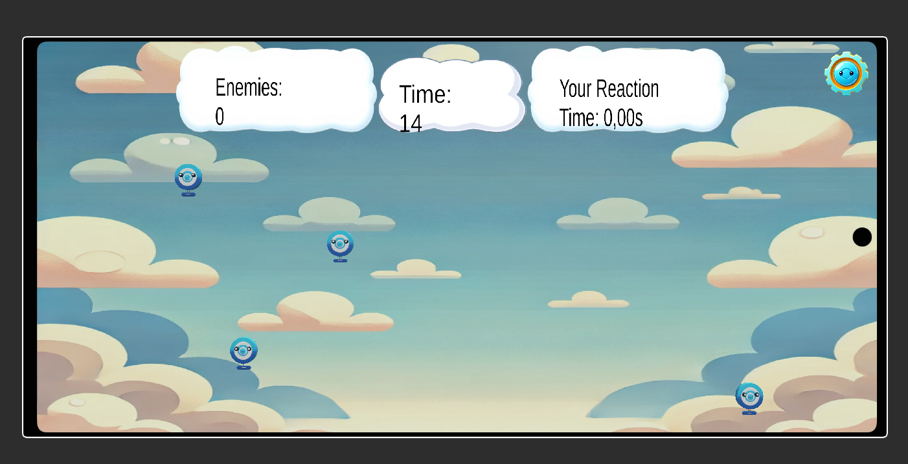

# Reaction Game

Reaction Game is an **Android** game developed with **Unity in C#**, where the player hits targets that appear on the screen. At the end of the game, the number of targets destroyed, average reaction time and shot accuracy are displayed.

**The 3D models were generated using ChatGPT-4 AI as an experiment in Unity integration. The C# code was developed without AI.**

## Features

- Selectable game duration: **10, 15 or 20 seconds**.
- Targets spawn at regular intervals in random positions.
- Configurable margins to define the target spawn area.
- Touch input to hit and destroy targets.
- Interface displaying the remaining time, targets destroyed and average reaction time.
- Pause menu with resume, restart and return to the main menu.
- Final screen displaying game statistics.

## Preview



[Gameplay video](Videos/ReactionTime.mp4)

## Repository structure

```text
Reaction-Game/
├── Assets/             Scenes, scripts, models and game assets
│   └── Script/         C# source code
├── Packages/           Unity dependency configuration
├── ProjectSettings/    Project settings
├── Videos/             Gameplay video
├── Screenshot.png
└── README.md
```

## Opening the project

Requires **Unity 2022.3.21f1**. Building for Android requires the **Android Build Support**, **Android SDK & NDK Tools** and **OpenJDK** modules, available through Unity Hub.

1. Clone the repository or download and extract the ZIP archive.
2. Add the project to Unity Hub by selecting the folder containing `Assets`, `Packages` and `ProjectSettings`.
3. Open the project with Unity 2022.3.21f1.
4. Wait for the assets to finish importing.
5. Open the main menu scene.

## Running on Android

1. Connect an Android device with USB debugging enabled.
2. Select Android as the build platform in the build settings.
3. Make sure the main menu comes before the game scene in the scene list.
4. Build and install the game on the device.

Gameplay uses touchscreen input: tap a target to destroy it.

## Game logic

Targets spawn using random viewport coordinates, converted into world positions through the camera. Configurable margins define the available area.

Touches are detected using raycasts. Each target records its spawn time; reaction time is calculated as the interval between spawning and being hit.

The game manager controls the timer, updates the interface and collects statistics. Final accuracy is calculated as the percentage of successful hits out of the recorded attempts.

## Project status

Learning project.
